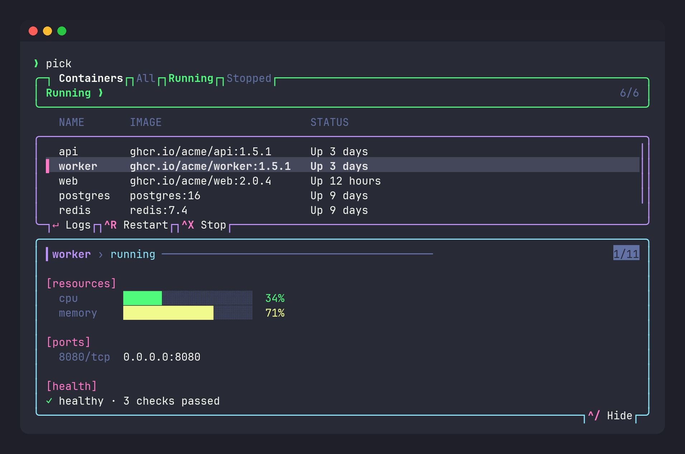
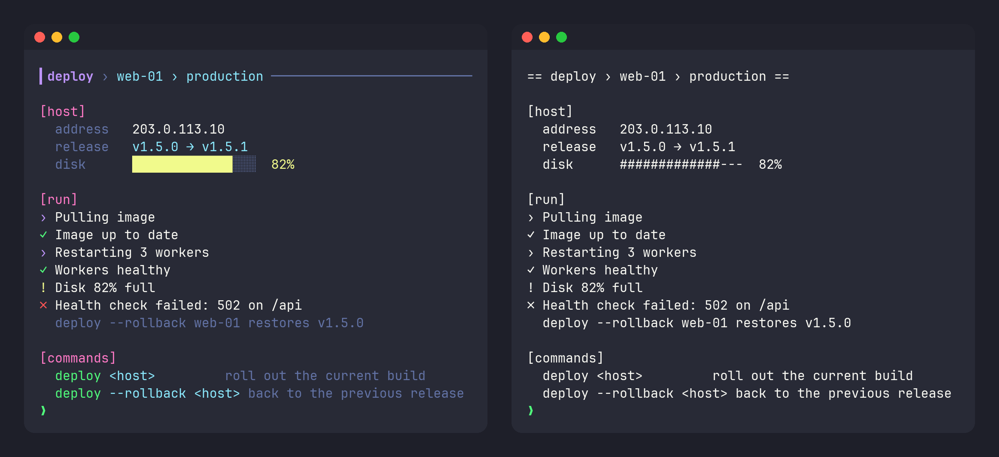

# zsh-ui

English | [简体中文](README.zh-CN.md)

One look for all your zsh tools. zsh-ui defines the output helpers (`_ui_*`) and the fzf look (`_ui_fzf_*`) that tools such as [command-finder](https://github.com/iskerwin/command-finder) and [zsh-remote](https://github.com/iskerwin/zsh-remote) use.



- **Tools work without it.** Each tool ships `ui-fallback.zsh`, a plain version of the same functions.
- **Install it and every tool switches to the same look**: colored status lines, help tables, and btop-style fzf pickers with rounded boxes, border titles and key hints.
- **Load order does not matter.** The fallback only defines what is still missing, so zsh-ui wins whether it loads before or after a tool.
- Colors are the 16 ANSI colors, so your terminal theme decides the palette.

The same tool output with zsh-ui (left) and with the fallback a tool ships (right):



## Install

**Homebrew**

```sh
brew install iskerwin/tap/zsh-ui
echo 'source "$(brew --prefix)/share/zsh-ui/zsh-ui.plugin.zsh"' >> ~/.zshrc
```

**[zap](https://github.com/zap-zsh/zap)**

```zsh
plug "iskerwin/zsh-ui"
```

**Manual**

```sh
git clone https://github.com/iskerwin/zsh-ui ~/.local/share/zsh-ui
echo 'source ~/.local/share/zsh-ui/zsh-ui.plugin.zsh' >> ~/.zshrc
```

### Load order

Anywhere works: tools pick zsh-ui up whether it loads before or after them. Load it before your own config that builds options at load time, such as an `FZF_DEFAULT_OPTS` made from `_ui_fzf_look`. With the other tools:

```zsh
plug "iskerwin/zsh-ui"                      # 1. anywhere; first is simplest
plug "zap-zsh/supercharge"                  # 2. compinit (or your own compinit call)
plug "iskerwin/zsh-remote"                  # 3. after compinit
CF_PATHS=( ~/.zshrc ~/.config/zsh ${ZSH_REMOTE_DIR-} )
plug "iskerwin/command-finder"              # 4. after zsh-remote, so CF_PATHS can list its commands
plug "zsh-users/zsh-syntax-highlighting"    # 5. widget-wrapping plugins last
```

## Contract

Everything below is a stable interface: names and arguments are only ever added, never renamed or changed. `ZSH_UI_VERSION` is `1`.

**Colors**: `_ui_palette [fd]` sets the associative array `$_ui` with the keys `r b it fg red grn ylw blu mag cyn gry` (reset, bold, italic, default, then colors). They are empty when the target (`fd`, default 1) is not a terminal or `NO_COLOR` is set; `UI_COLOR=always` / `never` overrides.

**Output**

| Function | Output |
|---|---|
| `_ui_head <title> [sub]` | Title line |
| `_ui_sect <name> [note]` | Section title after a blank line |
| `_ui_kv <key> <value> [color]` | Key-value line; key width `$_UI_KW` (default 10) |
| `_ui_cmd '<cmd args>' <description> [width]` | Help table row |
| `_ui_ok` `_ui_step` `_ui_hint` | ✓ done, › step, dim hint (stdout) |
| `_ui_warn` `_ui_err` | ! warning, ✗ error (stderr) |
| `_ui_usage <cmd> [args...]` | Usage line (stderr) |
| `_ui_confirm <question>` | Returns 0 on y/Y |
| `_ui_bar <percent> [width]` | Usage bar → `$REPLY` |
| `_ui_size <bytes>` | Human-readable size → `$REPLY` |
| `_ui_pad <text> <width>` | Pad to display width → `$REPLY` |

Fragments that go into a line are returned in `$REPLY`, not printed: `$(...)` would lose the color.

**fzf**

| Name | Use |
|---|---|
| `_ui_fzf_opts` | `fzf "${_ui_fzf_opts[@]}" <your options>` for a picker |
| `_ui_fzf_since <x.y[.z]>` | True when the installed fzf is at least that version: add options newer than your minimum only then, e.g. `_ui_fzf_since 0.61 && args+=( --ghost=... )`. `_ui_fzf_ver` puts the version number in `$REPLY` (0.66.1 → 66001, 0 without fzf) |
| `_ui_fzf_look` | The look alone, e.g. to build `FZF_DEFAULT_OPTS` |
| `_ui_fzf_inline` | Pointer and colors without boxes, for menus at the cursor (fzf-tab) |
| `_ui_fzf_label <color> <title>` | Border title → `$REPLY`; colors: `grn` input, `blu` list, `cyn` preview |
| `_ui_fzf_tabs <color> <title> <current> <views...>` | Title with view tabs → `$REPLY` |
| `_ui_fzf_keys <color> <key> <label> [...]` | Key hints → `$REPLY` |

Put the title on the input box (`--input-label`), key hints on the list (`--list-label`) and preview keys on the preview (`--preview-label`). The look needs fzf 0.58 or newer; the blank gutter appears from fzf 0.66.

## Using it in a tool

1. Copy [`ui-fallback.zsh`](ui-fallback.zsh) into your tool unchanged and source it when the tool loads.
2. Call the `_ui_*` functions directly.
3. Helper processes (an fzf `--preview` script, for example) cannot see shell functions. Source `$ZSH_UI_DIR/ui.zsh` when `ZSH_UI_DIR` is set, which the plugin exports, and your copy of the fallback otherwise.

```zsh
if [[ -n ${ZSH_UI_DIR-} ]]; then source $ZSH_UI_DIR/ui.zsh; fi
source ${0:A:h}/ui-fallback.zsh
```

## Development

```sh
zsh -f tests.zsh
```

The tests check that `ui.zsh` and `ui-fallback.zsh` define exactly the same names, and that zsh-ui wins in either load order.

## License

[MIT](LICENSE)
