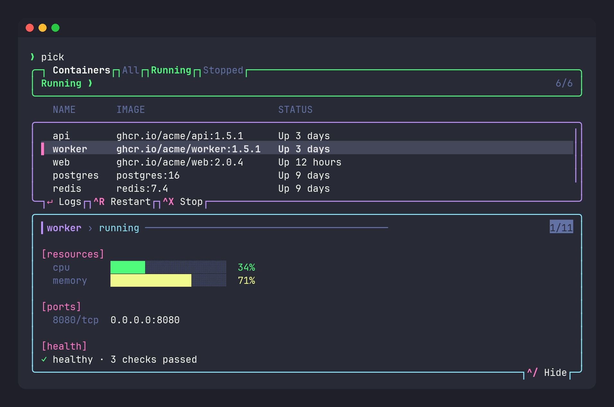
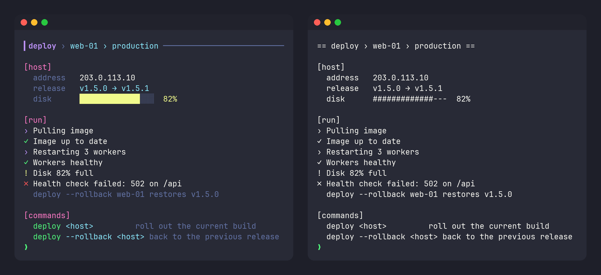

# zsh-ui

[English](README.md) | 简体中文

让你所有的 zsh 工具共用一套外观。zsh-ui 定义了输出辅助函数（`_ui_*`）和 fzf 样式（`_ui_fzf_*`），[command-finder](https://github.com/iskerwin/command-finder)、[zsh-remote](https://github.com/iskerwin/zsh-remote) 等工具都在用。



- **工具没有它也能用。** 每个工具自带 `ui-fallback.zsh`，是同一组函数的朴素版本。
- **装上它，所有工具就换成同一套外观**：彩色状态行、帮助表格，以及带圆角边框、边框标题和按键提示的 btop 风格 fzf 选择器。
- **加载顺序无所谓。** fallback 只定义还缺的函数，所以无论 zsh-ui 在工具之前还是之后加载，都以 zsh-ui 为准。
- 颜色只用 16 色 ANSI，调色板由你的终端主题决定。

同一个工具的输出，左边用 zsh-ui，右边用工具自带的 fallback：



## 安装

**Homebrew**

```sh
brew install iskerwin/tap/zsh-ui
echo 'source "$(brew --prefix)/share/zsh-ui/zsh-ui.plugin.zsh"' >> ~/.zshrc
```

**[zap](https://github.com/zap-zsh/zap)**

```zsh
plug "iskerwin/zsh-ui"
```

**手动**

```sh
git clone https://github.com/iskerwin/zsh-ui ~/.local/share/zsh-ui
echo 'source ~/.local/share/zsh-ui/zsh-ui.plugin.zsh' >> ~/.zshrc
```

### 加载顺序

放在哪里都行：无论 zsh-ui 在工具之前还是之后加载，工具都会用上它。如果你自己的配置在加载时就要用它构建选项，例如用 `_ui_fzf_look` 拼出 `FZF_DEFAULT_OPTS`，就把它放在那段配置之前。与其他工具一起：

```zsh
plug "iskerwin/zsh-ui"                      # 1. 任意位置；放最前最简单
plug "zap-zsh/supercharge"                  # 2. compinit（或你自己的 compinit 调用）
plug "iskerwin/zsh-remote"                  # 3. 在 compinit 之后
CF_PATHS=( ~/.zshrc ~/.config/zsh ${ZSH_REMOTE_DIR-} )
plug "iskerwin/command-finder"              # 4. 在 zsh-remote 之后，CF_PATHS 才能列出它的命令
plug "zsh-users/zsh-syntax-highlighting"    # 5. 包装 widget 的插件放最后
```

## 接口约定

下面所有内容都是稳定接口：名称和参数只会增加，不会改名或改变含义。`ZSH_UI_VERSION` 为 `1`。

**颜色**：`_ui_palette [fd]` 设置关联数组 `$_ui`，键为 `r b it fg red grn ylw blu mag cyn gry`（重置、粗体、斜体、默认色，然后是各颜色）。目标（`fd`，默认 1）不是终端或设置了 `NO_COLOR` 时，它们为空；`UI_COLOR=always` / `never` 可以强制指定。

**输出**

| 函数 | 输出 |
|---|---|
| `_ui_head <标题> [副标题]` | 标题行 |
| `_ui_sect <名称> [备注]` | 空一行后的小节标题 |
| `_ui_kv <键> <值> [颜色]` | 键值行；键宽为 `$_UI_KW`（默认 10） |
| `_ui_cmd '<命令 参数>' <说明> [宽度]` | 帮助表格的一行 |
| `_ui_ok` `_ui_step` `_ui_hint` | ✓ 完成、› 步骤、暗色提示（stdout） |
| `_ui_warn` `_ui_err` | ! 警告、✗ 错误（stderr） |
| `_ui_usage <命令> [参数...]` | 用法行（stderr） |
| `_ui_confirm <问题>` | 输入 y/Y 时返回 0 |
| `_ui_bar <百分比> [宽度]` | 用量条 → `$REPLY` |
| `_ui_size <字节数>` | 易读的大小 → `$REPLY` |
| `_ui_pad <文本> <宽度>` | 按显示宽度补齐 → `$REPLY` |

要拼进一行里的片段通过 `$REPLY` 返回，而不是打印：用 `$(...)` 会丢失颜色。

**fzf**

| 名称 | 用途 |
|---|---|
| `_ui_fzf_opts` | 选择器用 `fzf "${_ui_fzf_opts[@]}" <你的选项>` |
| `_ui_fzf_since <x.y[.z]>` | 已安装的 fzf 不低于该版本时为真：只在此时加入比你的最低版本更新的选项，例如 `_ui_fzf_since 0.61 && args+=( --ghost=... )`。`_ui_fzf_ver` 把版本号放进 `$REPLY`（0.66.1 → 66001，没有 fzf 为 0） |
| `_ui_fzf_look` | 只有外观部分，例如用来构建 `FZF_DEFAULT_OPTS` |
| `_ui_fzf_inline` | 只有指针和颜色、没有边框，用于光标处的菜单（fzf-tab） |
| `_ui_fzf_label <颜色> <标题>` | 边框标题 → `$REPLY`；颜色：输入框 `grn`，列表 `blu`，预览 `cyn` |
| `_ui_fzf_tabs <颜色> <标题> <当前> <视图...>` | 带视图标签的标题 → `$REPLY` |
| `_ui_fzf_keys <颜色> <按键> <说明> [...]` | 按键提示 → `$REPLY` |

标题放在输入框上（`--input-label`），按键提示放在列表上（`--list-label`），预览相关按键放在预览上（`--preview-label`）。外观需要 fzf 0.58 或更高；留白的 gutter 从 fzf 0.66 开始出现。

## 在工具中使用

1. 把 [`ui-fallback.zsh`](ui-fallback.zsh) 原样复制到你的工具里，在工具加载时 source 它。
2. 直接调用 `_ui_*` 函数。
3. 辅助进程（例如 fzf 的 `--preview` 脚本）看不到 shell 函数。设置了 `ZSH_UI_DIR`（插件会导出它）时 source `$ZSH_UI_DIR/ui.zsh`，否则 source 你复制的 fallback。

```zsh
if [[ -n ${ZSH_UI_DIR-} ]]; then source $ZSH_UI_DIR/ui.zsh; fi
source ${0:A:h}/ui-fallback.zsh
```

## 开发

```sh
zsh -f tests.zsh
```

测试检查 `ui.zsh` 和 `ui-fallback.zsh` 定义的名称完全一致，并且无论哪种加载顺序都以 zsh-ui 为准。

## 许可证

[MIT](LICENSE)
